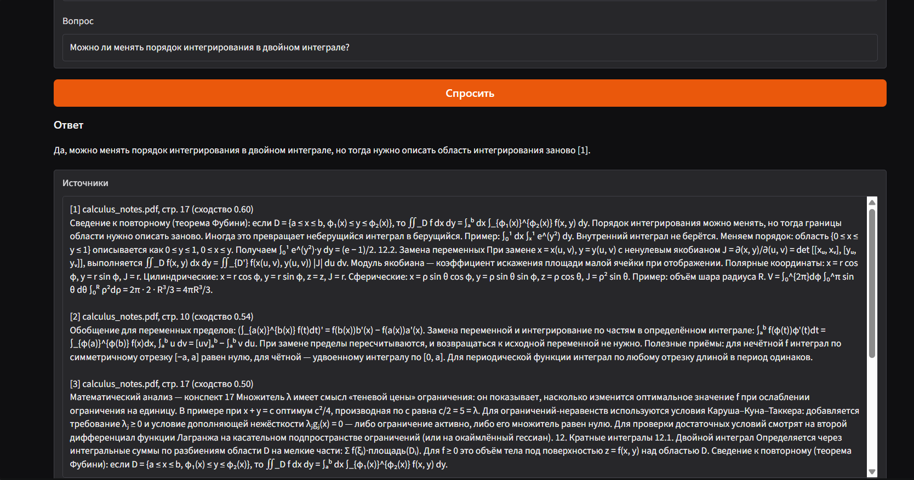

# Вопросы по конспектам (RAG)

Перед экзаменом я постоянно искал в своих PDF, где же было определение или формулировка теоремы. Этот проект решает ровно эту задачу: загружаешь конспекты, спрашиваешь своими словами и получаешь ответ со ссылкой на файл и страницу. Если ответа в конспектах нет, приложение так и говорит, а не сочиняет.

Всё работает локально на одной видеокарте с 8 ГБ, без внешних API, так что конспекты никуда не отправляются.



## Как пользоваться

1. Запусти `python app.py` и открой адрес из консоли.
2. Перетащи один или несколько PDF или TXT.
3. Задай вопрос, например: «Почему явная схема для теплопроводности устойчива при r ≤ 1/2?».
4. Под ответом будут фрагменты, по которым он построен: файл, страница, текст. Формулы отображаются как формулы.

Ответ на вопрос занимает около 20 секунд, на вопрос не по теме отказ приходит сразу.

## Что внутри

Сначала текст режется на фрагменты до 1000 символов по границам предложений, у каждого запоминается страница. На вопрос ищутся 5 подходящих фрагментов двумя способами сразу: BM25 ловит точные термины вроде «Бройша–Годфри», а эмбеддинги `bge-m3` — совпадения по смыслу, когда в вопросе другие слова. Два рейтинга объединяются через Reciprocal Rank Fusion.

Если даже лучший фрагмент мало похож на вопрос (сходство ниже 0.52), система сразу отвечает «в документах этого нет», не тратя время на модель. Иначе фрагменты уходят в `Qwen2.5-7B-Instruct`, сжатую до 4 бит, чтобы поместиться в 8 ГБ, с инструкцией отвечать только по ним.

## Насколько хорошо это работает

Чтобы не верить на глаз, я собрал проверочный набор: 50 вопросов по трём конспектам (матанализ, эконометрика, уравнения в частных производных, 64 страницы). Сами конспекты сгенерированы с помощью LLM, а вопросы я писал вручную, своими словами, и для каждого отметил место в тексте, где лежит ответ. 10 вопросов с ответом и 5 без ушли на настройку (dev), остальные 30 + 5 я запускал только в конце (test).

**Ответы.** Я вручную разметил все 30 тестовых ответов: верный ли ответ и всё ли сказанное есть в найденных фрагментах. Поиск одинаковый, меняется только модель:

| Модель | Верные ответы | Без выдумок | Отказ, где ответа нет | Время ответа |
|---|---|---|---|---|
| Qwen2.5-1.5B | 50% | 70% | 3 из 5 | 2 с |
| **Qwen2.5-7B, 4 бита** | **70%** | **87%** | **5 из 5** | 19 с |

Маленькая модель часто держала правильный фрагмент перед глазами и всё равно путала факты: например, назвала признак Даламбера сильнее признака Коши, хотя в тексте написано наоборот. Иногда она отвечала по-английски. 7B исправила 8 таких ошибок и сделала 2 новые. На двух вопросах без ответа, которые проскочили порог, 1.5B выдумала ответы, а 7B оба раза честно отказалась. Поэтому в приложении стоит 7B: для подготовки к экзамену точность важнее скорости.

Честно о значимости: на 30 вопросах тест Макнемара даёт p ≈ 0.11, так что улучшение заметное, но строго не доказано.

**Поиск.** Нужный фрагмент попадает в топ-5 для 26 из 30 тестовых вопросов (recall@5 0.867, MRR 0.703). Оставшиеся 4 вопроса модель не может ответить в принципе, и это главный предел точности сейчас.

Настройки я выбирал на dev, где гибрид с `bge-m3` нашёл ответ для всех 10 вопросов при любом размере фрагмента, а старая модель эмбеддингов `MiniLM-L12` проваливалась на половине конфигураций. Но на test гибрид не обогнал обычный BM25: тот нашёл столько же (0.867) и в среднем ставил нужный фрагмент чуть выше (MRR 0.742). Десяти вопросов на dev оказалось мало, чтобы это увидеть. Следующий шаг — расширить dev и попробовать переранжирование.

**Отказы.** Порог 0.52 подобран на dev. На test система правильно решает, отвечать или нет, в 83% случаев.

Все размеченные ответы лежат в [`eval/results`](eval/results), их можно проверить.

## Запуск

Нужны Python 3.12 и видеокарта NVIDIA с 8 ГБ памяти.

```bash
python -m venv .venv
.venv\Scripts\activate            # Linux/macOS: source .venv/bin/activate
pip install torch==2.11.0 --index-url https://download.pytorch.org/whl/cu128
pip install -r requirements.txt
python app.py
```

При первом запуске скачаются `bge-m3` (около 2.3 ГБ) и Qwen2.5-7B (около 15 ГБ). Если видеокарта слабее, поставь в `rag/config.py` `LLM_MODEL = "Qwen/Qwen2.5-1.5B-Instruct"` и `LLM_4BIT = False`: будет быстрее, но менее точно.

Если Gradio падает с ошибкой 502, значит VPN или системный прокси перехватывает локальные адреса. Помогает `NO_PROXY=localhost,127.0.0.1`.

Тесты не скачивают модели и проходят за пару секунд:

```bash
python -m pytest -q
```

Повторить оценку:

```bash
python evaluate.py search                 # сравнение вариантов поиска на dev
python evaluate.py threshold              # порог на dev, проверка на test
python evaluate.py answers --model Qwen/Qwen2.5-7B-Instruct --4bit --out eval/answers_7b.csv
python evaluate.py score --out eval/answers_7b.csv   # после ручной разметки
```

## Устройство кода

```
rag/
  loaders.py     читает PDF по страницам и TXT
  chunking.py    режет текст на фрагменты по предложениям
  retriever.py   BM25 + эмбеддинги, объединение рейтингов
  generator.py   промпт и генерация ответа
  pipeline.py    поиск → порог → ответ, вывод источников
  config.py      все настройки в одном месте
app.py           веб-интерфейс на Gradio
evaluate.py      оценка поиска, подбор порога, подсчёт разметки
eval/            конспекты, вопросы, размеченные ответы
tests/           тесты с подставной моделью эмбеддингов
notebooks/       первый прототип в Colab
```

## Что пока не так

- Конспекты синтетические и аккуратно свёрстанные. На настоящих, с формулами, таблицами и кривой вёрсткой, качество, скорее всего, будет ниже. Сканы без текстового слоя не читаются.
- 30 тестовых вопросов и разметка одним человеком дают ориентир, а не точную цифру.
- Колонтитулы страниц попадают во фрагменты и немного мешают поиску.
- Модель не всегда ставит ссылки [n] на фрагменты, поэтому источники показываются отдельно.
- На раннем этапе я один раз посмотрел таблицу поиска на test со старой моделью эмбеддингов и после этого перенёс все сравнения на dev.

## С чего началось

Первая версия была ноутбуком в Colab, который искал по одному текстовому файлу: [`notebooks/prototype.ipynb`](notebooks/prototype.ipynb).
